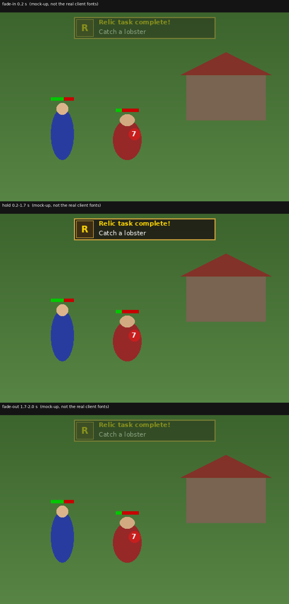

# Task-complete toast (feasibility)

**Question (Calum, 2026-10-11):** can a small non-blocking widget appear at the top of the screen when a relic task completes, fade out after about 2 seconds (like OSRS combat achievements / collection log popups), without blocking much screen during combat? How much work, and will it look good?

Based on: root `0cb0d24`, Engine-TS `33564f19`, Content `b36ee553b`, Client-TS `8adf2b8`. Method: read only. Nothing implemented, nothing run, no real-client screenshot. The mock-up image is drawn offline with a generic font, not the client's own fonts.

## What exists today (read)
- Completion: `[queue,relic_task_done]` (`mods/relics/scripts/relic_offer.rs2:286`) calls `~relic_say("Relic task <n> complete!")` (`:291`), which is `mes(...)` plus a console line (`relic_state.rs2:7`), then `~relic_celebrate` (fireworks + jingle). The task's name is available as `~relic_task_name(n)` (`relic_menus.rs2:29`).
- The client already draws things on top of the 512x334 game view each frame in `otherOverlays()` (`Client-TS/src/client/Client.ts:4888`, called at `:4301`; the view buffer is `new PixMap(512, 334)`, `:2040`). A custom precedent is the `::fpson` text drawn there (`:4928`).
- The client has translucent primitives: `Pix2D.fillRectTrans(x,y,w,h,rgb,alpha)` (`Pix2D.ts:68`, alpha 0-256) and `PixFont.plotLetterTrans` (`PixFont.ts:392`, already used with a varying alpha by `drawStringAntiMacro`, `:231-234`). No public "draw string with alpha" helper exists, so a small one is needed.

## Approach A: client-drawn toast, triggered by a game message (recommended)
1. Server: in `relic_task_done`, `mes("<task name>:relictask:")` (or similar). Precedent: the client's `MESSAGE_GAME` handler already routes messages ending in `:tradereq:` / `:duelreq:` to special handling and only otherwise calls `addChat` (`Client.ts:6497-6532`). Add a third branch for the new suffix that starts the toast instead of adding a chat line. No new packet, no engine change. The existing "Relic task N complete!" chat line stays as the log.
2. Client: a few fields (`toastText`, `toastStart` from `performance.now()`), and a draw call at the end of `otherOverlays()`: panel via `fillRectTrans`, 1 px gold border, title and task name, alpha = ramp in over about 0.2 s, hold, ramp out over the last 0.3 s of the 2 s. Fade is per frame, not per 0.6 s tick, so it is smooth. It takes no clicks (nothing is added to the minimenu), so it cannot block play.
3. Tests: server side in the headless harness (the message is sent when the task completes; harness records game messages, see `docs/setup/headless-test-harness.md`). Client side: put the alpha-by-time function in a pure module and unit test it with bun like `Client-TS/test/camera-pitch.test.ts`. Drawing itself is "not covered by the harness" and needs a real-client look.
4. Effort: roughly 60-100 lines of client code, one line of RuneScript, two or three tests, a docs note. About half a day including the visual check. Client-TS is a fork, so it is one commit there plus the pointer in root. Touches one upstream file (`Client.ts`), small merge surface.
5. Extra: the same toast could announce relic gained, quest pass or win later with a different suffix.

## Approach B: overlay interface (pure content, no client change)
`if_openoverlay(<toast interface>)` for the toast, then `queue` a 3-tick timer that does `if_openoverlay(null)`. Findings against it:
- There is only one overlay slot: `Player.overlay` (`Engine-TS/src/engine/entity/Player.ts:2061`; the client has a single `mainOverlayId`, `Client.ts:4904-4907`). The wilderness skull/level overlay uses it (`Content/scripts/login_logout/login.rs2:21-23`, `wilderness.rs2:2`, and `wilderness_exit` does `if_openoverlay(null)` at `wilderness.rs2:12`) as does the maze timer (`macro_event_maze.rs2:9`). A toast would hide the wilderness level display and its close would erase it, so the script would have to restore the previous overlay (state-tracking in the mod).
- No fade: there is no server packet that sets a component's transparency (`ServerProt.ts` has `IF_SETCOLOUR`, `IF_SETHIDE`, `IF_SETTEXT`, etc. but nothing for `trans`; `trans` is read once from the packed interface, `IfType.ts:128`). A stepped fake (stacked layers hidden one by one) would move on 600 ms ticks, so it looks choppy; text colour can be stepped with `IF_SETCOLOUR` but not blended.
- Timing is in game ticks, so "2 seconds" is 3 or 4 ticks.
- Effort is low (about 1-2 hours, content only) but the result is the weakest.

## Approach C: dedicated server packet
A new `ServerProt` (engine encoder, RuneScript command, client decoder) to carry text and duration cleanly. Same look as A but touches Engine-TS, Content `engine.rs2` and the client, with more upstream-merge risk. Not needed for one string; only worth it if many popup kinds appear. Roughly a day.

## What it looks like and how much screen
Proposed panel 250x38 px at the top centre of the 512x334 game view (y 8-46): about 5.6% of the view area, a thin strip with nothing important in it in normal play (the wilderness icon is bottom right, the minimenu and hit splats are on the entities). It is translucent (the scene shows through) and takes no clicks. Mock-up with the three phases (not the real client fonts, so the real one will be pixel-font style): `docs/assets/task-toast-mockup.png`.

Inference: it will look good enough and familiar (dark panel, gold border, title + task line); how it reads against the real bright scenery and client fonts is not verified. A narrower panel (about 200 px) is possible if the longest task name ("Defeat the Kalphite Queen") fits; text width not measured.

## Recommendation
Approach A. It is the only one that gives a real fade, uses no scarce overlay slot, and is a small, self-contained client change. Start with a failing harness test for the server message.

## Not checked
No client built or run; whether `Client.ts` has any other consumer of messages ending in a `:...:` suffix besides the two seen; whether another per-frame draw (e.g. under the minimap viewport variants or the camera work) alters the 512x334 buffer assumption; width of the fonts.
